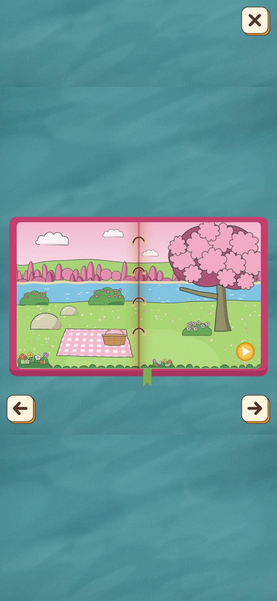
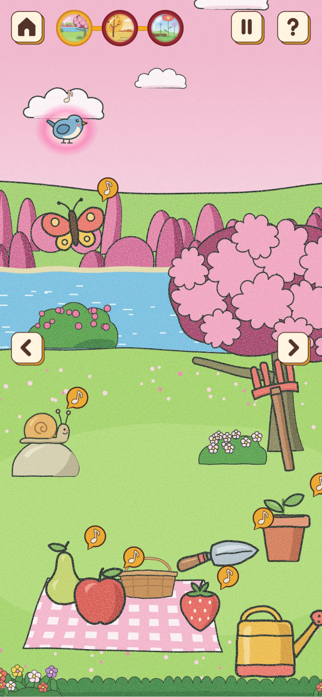
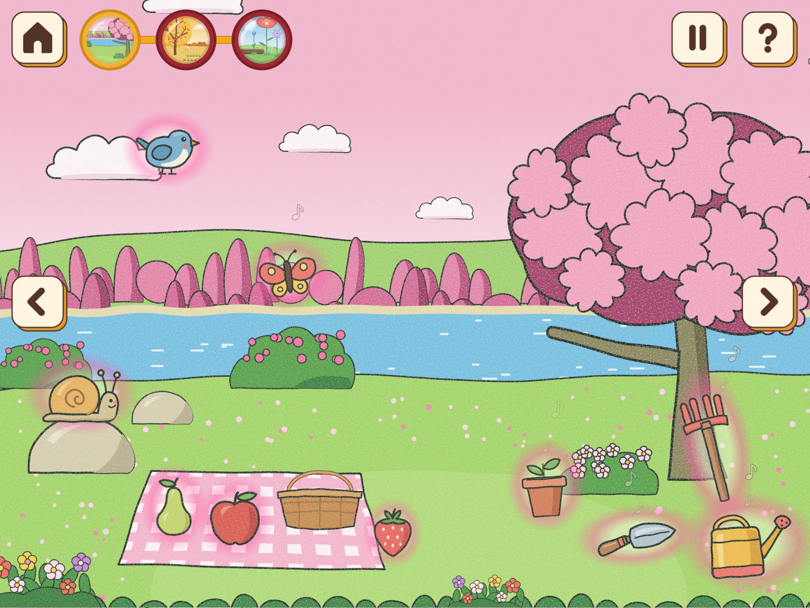
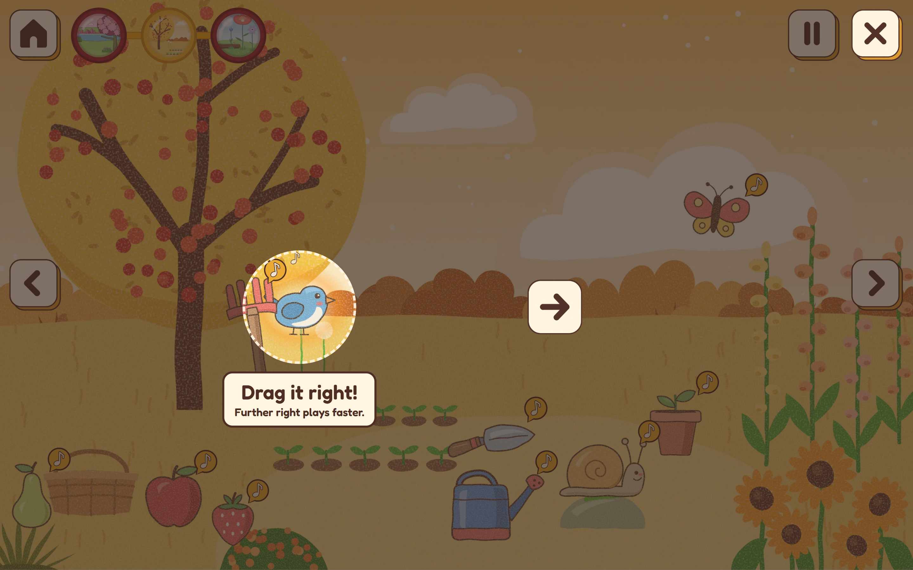
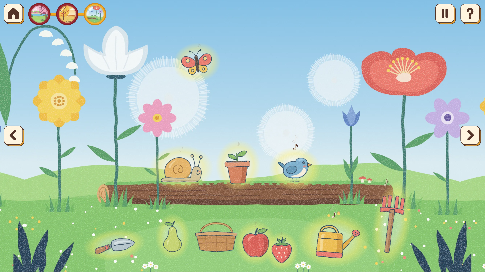

# Garden of Sounds

Garden of Sounds is a browser-based musical toy for toddlers. Children tap and drag gardening
tools, animals and fruits around an illustrated storybook garden to build layered music.

This repository holds the final instrument for Assignment 3. There are three versions of the
garden. Each one is a still picture with ten separate objects on it that can be moved and played,
and it fills the whole browser window.

## Structure

- `index.html` provides the interactive storybook interface, including page navigation, garden
  selection and a dedicated information panel for accompanying adults. `storybook.js` manages
  page transitions, sound effects and navigation into the gardens, while `style.css` defines
  the storybook's visual layout and responsive behaviour.
- `base.css` defines shared colours, picture buttons, responsive garden layouts, objects and
  visual feedback.
- `garden.js` manages sound synthesis, musical scheduling, object interaction and the guide
  shared by all three gardens.
- `button-press.js` manages button press feedback and dismissal of the phone orientation prompt.
- `assets/textures/` contains the paper-grain texture.
- `assets/storybook/` contains the cover, spreads, backdrop and book graphics.
- `assets/buttons/` contains navigation controls, chapter buttons, musical cues and guide graphics.
- `assets/fonts/` contains the locally loaded Fredoka font and font licence notices.
- `versions/` contains `lakeside-picnic/`, `painted-orchard/` and `flower-meadow/`. Each includes:
  - `index.html`: scene objects, navigation, musical key and tempo.
  - `style.css`: scene-specific colours and responsive object positions.
  - `assets/backgrounds/`: wide, tall and phone garden backgrounds.
  - `assets/objects/`: the ten playable object illustrations.

## Garden versions

All three gardens share the same painted gouache texture, and each has its own main colour, key
and tempo. They keep the same ten object IDs and play by the same rules.

- `versions/lakeside-picnic/` is pink, in C at 76 beats per minute: a bold-outlined lakeside
  meadow with a blossom tree and a picnic blanket.
- `versions/painted-orchard/` is golden orange, in D at 84 beats per minute: an orchard with no
  scenery outlines, tall foxgloves and rows of seedlings.
- `versions/flower-meadow/` is blue and green, in F at 92 beats per minute: a bug's-eye meadow
  with giant flowers, dandelion puffs and a fallen log that the snail, flowerpot and bird sit on.

## How it plays

The mapping and feedback come from peer testing of the eight Assignment 2 prototypes.

- **One piece of music.** Testers heard the garden as noise once several objects played, because
  each kept its own clock and roamed over three octaves. Now the whole garden keeps one beat at
  its own tempo and one slow round of chords, I, vi, IV and V, two bars each, and every note an
  object plays belongs to the chord of that moment. However many objects play, they play
  together, in time and in harmony.
- **Height picks the notes.** Prototype 1 changed the register in three steps, but a tester
  moved an object a little and heard nothing change, so height now picks one of eight rungs on a
  ladder of the chord's notes, from the bottom of the window to the top. Tools start an octave
  below the animals and fruits, so they sit under the melodies.
- **Every object has its own notes.** Each object plays only from its own small set of rungs above
  the one its height picks: the bird runs up and down four neighbouring notes, the butterfly
  leaps, the snail stays close to home and the rake marks the chord's root and its octave.
- **Left to right controls rhythm.** Horizontal position determines rhythmic speed using
  predefined patterns synchronised to the shared beat. The system contains six rhythmic
  patterns, with different selections available to each sound family. Gardening tools and
  animals use five patterns, while fruits are restricted to four slower patterns. Horizontal
  movement also introduces gentle stereo panning.
- **The kind of object picks the sound family.** Gardening tools are soft drums, animals sing
  the melody and fruits are slow ambient textures.
- **Resting objects breathe.** Each one swells a little every few seconds, so a child can see
  what can be touched without any words. Playing objects stop, since every note moves them.
- **It looks like an instrument.** Testers took the garden for a picture to tidy and tried to
  put the fruit in the basket. Until an object has played, a small note in a gold bubble bobs at
  its corner, so every object says it makes music, and the bubble fades once the object has sung.
- **One tap is enough.** A tap starts the object singing straight away and another tap stops it;
  dragging starts playback before release, with pitch and rhythm following its position. It glows
  along its outline, adapted from Prototype 5.
- **Every note moves the object,** adapted from Prototype 8. Tools sway, animals hop and fruits
  swell, which reuses Prototype 4's grow-and-bounce as a repeating effect.
- **Playing objects glow.** A playing object keeps a faint, soft halo in the garden's colour
  that pulses gently with each note, and a small note floats up from it, so a child can see which objects
  are making music.
- **Play the whole garden.** The button in the top corner lets every object join in, one after
  another in a new random order each time and each on its next beat, so a child who taps nothing
  still hears the garden sing as one piece. While anything is playing the same button shows pause and stops it all.
- **A guide to play along with.** A tester watched the old demonstration and still did not know
  what to do, so the question-mark button now starts a guide. The garden dims, one animal is lit
  and a hand taps it with "Tap here!"; once the child taps it, the hand shows dragging it up or
  down, then to the right, to an arrow that stays in place; right rather than left, because a
  speed-up is heard at once while a slow-down takes a while to notice. Each step passes as soon
  as the animal comes most of the way to its arrow, even before the finger lifts. It starts by
  itself once across all gardens in the same browser, and the cross or Escape ends it.
- **One look.** The orchard and meadow objects have their outlines softened towards each
  garden's own deep colour, so they sit in those painterly pictures as the lakeside objects sit
  in its outlined one.
- **Hints.** When a garden opens, and after 20 seconds of quiet, the playable objects wiggle one
  after another, so they stand apart from the flowers, basket and lake in the picture.
- **Drop to place.** Putting an object down starts it singing from its new place, and a small
  ripple spreads across the ground, adapted from Prototype 6. Dragging starts the shared musical
  playback and gives immediate feedback when pitch or rhythm changes, using the same synth.
- **Controlled randomness.** Every tap makes the object a new short tune from its own set of
  notes, so the same object sounds different each time it is started but always like itself. The
  tune repeats as the object's own song, but each time round one note may swap for another from
  the set, with small changes in loudness, so it never quite repeats. Animals sometimes rest
  between notes, the whole tune moves up or down as the object does, and the chords underneath
  give the same tune a new colour every two bars.
- **A welcome tune.** Opening the storybook plays a short, bouncy run of notes with a bass bounce
  and a slide-whistle swoop, one of a few, so the toy greets a child before anything is tapped.
- **Keyboard.** Tab moves between objects, Enter or Space starts and stops them, and the arrow
  keys move them.

Prototype 7's continuous spinning is not used. Prototype 2's continuous pitch was tried after
testing showed the three-step mapping too hard to notice, but sixteen free steps per object
sounded like noise together, so height now moves in eight steps that always fit the chord.

### Rhythm pattern definitions

`garden.js` defines six patterns. Hit positions are zero-based sixteenth-note positions within
one repeating cycle; they describe scheduled opportunities to play, before any animal rests.

| Index | Cycle length | Hit positions | Available to |
| --- | --- | --- | --- |
| 0 | 16 sixteenths | 0 | Fruits |
| 1 | 16 sixteenths | 0, 8 | Tools, animals and fruits |
| 2 | 16 sixteenths | 0, 6, 12 | Tools, animals and fruits |
| 3 | 16 sixteenths | 0, 4, 8, 12 | Tools, animals and fruits |
| 4 | 8 sixteenths | 0, 3, 6 | Tools and animals |
| 5 | 8 sixteenths | 0, 2, 4, 6 | Tools and animals |

The two uneven patterns have gaps of 6–6–4 and 3–3–2 sixteenths respectively: the same 3:3:2
proportion at different speeds. The rightmost tool/animal pattern schedules two notes per
quarter-note beat; fruits stop at the four-hits-per-16-sixteenths pattern.

## Prototype testing and final design decisions

Assignment 2 compared eight parallel prototypes: three explored spatial sound mapping and five
explored visual feedback. The A2 page documents the interactions, development logs and a peer
feedback form. The following findings summarise qualitative peer feedback and the design
decisions informed by Assignment 2 testing. This feedback does not establish usability for all
toddlers aged 1–3; further testing with children and accompanying adults is needed.

| Prototype | What it explored | Decision carried into the final instrument |
| --- | --- | --- |
| 1 — Three pitch zones | Low, middle and high registers selected by where an object is dropped. | Keep the relationship between height and pitch. A tester reported that a small movement produced no audible change, so replace the three broad zones with eight chord-note steps. |
| 2 — Continuous vertical pitch | Up/down movement changes frequency continuously. | Keep immediate pitch feedback during dragging. Continuous pitch was explored, but the final layered instrument uses eight chord-compatible steps rather than unrestricted frequency changes. |
| 3 — Note and octave mapping | Vertical position selects notes; horizontal position selects octaves, with two repeating objects. | Keep two-axis control and layering, but give the axes distinct roles: height selects pitch and left/right position selects rhythm. Use a shared beat and chord progression. |
| 4 — Object movement | A tapped flower briefly grows and bounces. | Adapt the movement into object-specific responses: tools sway, animals hop and fruits swell. |
| 5 — Colour and glow | A tap brightens the flower and produces a temporary glow. | Use an outline glow and a soft playing-state halo so the active object remains recognisable. |
| 6 — Environmental ripple | Ripples extend the response into the surrounding garden. | Use a small ground ripple on placement and background taps to acknowledge contact with the scene. |
| 7 — Playing-state feedback | Continuous spinning indicates a repeating sound; another tap stops it. | Keep tap-to-start/tap-to-stop interaction, but omit continuous spinning. Show the playing state through glow, floating notes and note-timed movement. |
| 8 — Rhythm feedback | Movement occurs with every musical note. | Synchronise repeated visual responses with each object's notes, communicating both activity and rhythm. |

### Main findings and responses

- **Layering needed musical boundaries.** Peer feedback described several independently timed
  objects across a wide pitch range sounding like noise. The final garden uses a shared musical
  clock, predefined rhythmic patterns and an I–vi–IV–V chord progression, with each chord lasting
  two bars. Notes follow the current chord; tools sit below animals and fruits to support
  coherent layered playback.
- **Movement needed a noticeable result.** Three broad pitch zones made small movements hard to
  hear. The final design uses eight height steps within the chord, with rhythm changes while
  dragging horizontally. It balances audible change with compatible layered notes.
- **Playable objects needed clearer cues.** Testers interpreted the scene as a picture to tidy
  and tried placing fruit in the basket. Idle breathing, occasional wiggles and note badges
  now distinguish musical objects from scenery. These cues support discovery without requiring
  written instructions.
- **A demonstration needed participation.** One tester still did not know what to do after
  watching the earlier demonstration. The final guide asks the player to tap an animal, move
  it vertically and then drag right. Each step responds to the player's action; moving right
  demonstrates a speed increase that is easier to notice immediately than a slowdown.
- **Feedback needed to identify both the source and timing.** The final combination uses
  immediate press feedback, outline glow, a persistent soft halo and movement on each note.
  The ripple acknowledges placement, while the object remains the main source of feedback.

The final instrument therefore combines spatial exploration, bounded randomness and a shared
musical structure. Each object retains a recognisable sound family and a small set of notes,
while new short tunes and small variations keep repeated play from becoming identical. The
storybook and three garden scenes provide different moods while preserving the same controls.
Large targets, keyboard controls, picture buttons and a grown-ups' panel support accompanied play.

Sources: [Assignment 2 prototype documentation](https://wendy-area-1-prototype-1.github.io/My-Instrument-Garden-of-Sounds/assignment2.html)
and the testing observations recorded in [How it plays](#how-it-plays).

## Browser testing record

On **27 October 2026**, the running instrument was checked in **Google Chrome 156.0.8078.48**
using DevTools Responsive mode at four viewport sizes in CSS pixels. The test URL was
`http://127.0.0.1:4187/`, with the gardens using `?v=picture-book-20261026h`. The served `garden.js`
matched the final-instrument working-copy file after newline normalization; the source revision
was `dd04d7c1b2e7413468a35c34bb67dcaa91221ed2`. Documentation changes do not alter that instrument code.

### Viewport results

| Range | Viewport (CSS px) | Scene | Observed results | Screenshot |
| --- | --- | --- | --- | --- |
| Medium · below 840px | 390 × 844 | Lakeside Picnic | Book opened and turned; garden entered; bird tapped and dragged on both axes; status changed from “middle, quickly” to “high up, slowly”; Stop-All returned “All quiet”. | [View](assets/testing/chrome-garden-390x844.webp) |
| Expanded · 840–1199px | 1024 × 768 | Lakeside Picnic | Scene and controls remained visible after resizing; Play-All displayed “The whole garden is playing” with halos and floating notes; Stop-All returned “All quiet”. | [View](assets/testing/chrome-garden-1024x768.webp) |
| Large · 1200–1600px | 1440 × 900 | Painted Orchard | Chapter navigation opened the orchard; the guide advanced through tap, drag down and drag right, then displayed “Your turn!”; Stop-All returned “All quiet”. | [View](assets/testing/chrome-guide-1440x900.webp) |
| Extra-large · above 1600px | 1920 × 1080 | Giant Flower Meadow | Chapter navigation opened the meadow; bird activated; Tab focused the butterfly, Space activated it and Right moved it; Play-All and Stop-All updated their visible states. | [View](assets/testing/chrome-garden-1920x1080.webp) |

The checks establish the responses listed in each row, rather than every feature at every size.
All four layouts were inspected for visible scene content and reachable navigation/play/help
controls. Book navigation was tested at the portrait size; navigation between all three gardens
was observed across the run. The guide completed its tap, vertical-drag and horizontal-drag
stages, ending with “Your turn!”. At 1920 × 1080, Tab visibly focused the butterfly, Space
activated it, and Right moved it. Stop-All returned the visible “All quiet” state.

### Screenshot evidence

Screenshots were captured through Chrome's device-toolbar **Capture screenshot** action. The
CSS viewport settings were 390 × 844, 1024 × 768, 1440 × 900 and 1920 × 1080. Captures have
approximately 2× pixel density; the portrait image height has a one-pixel rounding difference.
The images are lossless WebP conversions of the Chrome PNG captures, with no compositing or
removal of interface elements. [Evidence metadata](assets/testing/evidence.json) records both
CSS viewport sizes and actual image dimensions.

### Limitations and console observations

- This was desktop Chrome viewport emulation, not a physical-device or multi-browser test.
- Playback and mapping results above are visual/status observations. Audible pitch, timing,
  volume quality and silence after stopping were not assessed by listening.
- Physical multi-touch, reduced-motion preferences, prolonged use and every feature at every
  viewport were not tested in this run.
- Chrome reported a missing `favicon.ico` (HTTP 404). During Play-All it also displayed Tone.js's
  warning that events scheduled inside callbacks should use the passed-in scheduling time.
  These observations remain recorded; the run is not described as console-error-free.
- The earlier published-build Chrome checks confirmed book opening, page turning, garden entry
  and play/stop interface states but did not record viewport dimensions. The screenshots and
  measured viewport record above provide the current responsive evidence.

## Designed for young children

The toy is made for toddlers (about 1 to 3 years) playing with a grown-up nearby, following
guidance on kid-friendly UX:

- **Big targets.** Buttons and objects are at least 44 pixels across, around 75 on a roomy
  screen, and objects have an invisible margin so small fingers can hit them. No button sits
  along the bottom edge, where children tap by mistake.
- **The garden comes first.** On a phone the buttons shrink to their smallest comfortable size
  and the garden objects grow, so the objects stay the biggest things on a small screen.
- **An answer for every touch.** A pressed object squashes at once, a tap glows and sounds, and a
  tap on the garden itself sends a small ripple.
- **Many fingers.** Several objects can be tapped or dragged at the same time, so siblings can
  play together. Only the first finger turns the book's pages.
- **Pictures, not words.** Pages, buttons and gardens are pictures; the few words are for
  grown-ups.
- **Any way up.** The book and the gardens work on an upright screen. An upright phone is asked
  once to turn sideways, where there is more room, and the card can be put away to play upright.
- **Grown-ups' corner.** Help for grown-ups is kept away from the child's buttons, in a small
  label lettered like the cover. It shows the two moves with the same arrow pictures as the
  gardens' guide.
- **Play for its own sake.** There are no scores, rewards, timers, ads or sign-ups, and no
  personal information is asked for.

## Final references, assets and tool credits

### Assignment 1 design references

The following references were recorded in
[Assignment 1](https://wendy-area-1-prototype-1.github.io/My-Instrument-Garden-of-Sounds/assignment1.html). Their roles describe the
project's design rationale; they are not claims that their code or assets were incorporated.

| Reference | Contribution to the design |
| --- | --- |
| [Gear Ratio Drum Machine](https://10kdrummachines.com/machines/gear-ratio/gear) | Information design and mapping: make musical relationships visible through spatial interaction. |
| Dinahmoe, [PLINK!](https://dinahmoelabs.com/plink/) | Immediate audiovisual feedback connecting an action with its musical result. |
| Marina Budarina, [Chimes](https://marinabudarina.github.io/chimes/) | An inviting physical metaphor and expressive visual characterisation. |
| Aurensnyder, [UN / CYCLE](https://aurensnyder.com/JUNK/cycle.html) | Discoverable interaction and open exploration without scoring or failure states. |
| Pham S, Tran H, et al. (2025), [Glow Up Again, Mom!](https://www.behance.net/gallery/227352429/Glow-Up-Again-Mom) | Tactile illustration, simplified forms, environmental storytelling and expressive colour, as credited in A1. |

### Final storybook and child-friendly design references

- Sophia Guo, [Coffee Table Book](https://sophiaguo.design/playground/picture-book/): opening the
  book, turning spreads and closing it with a cross.
- Kerrygold / Makemepulse, [The Magical Pantry](https://www.themagicalpantry.com/): activities
  within spreads and a phone orientation prompt.
- Ribbit, [Process](https://ribbit.dk/process/): zooming from an open book into its content.
  These references informed the storybook's interaction design; their code and artwork were not incorporated into the project.
- KidsWorldFun Editorial Team, [Kid-Friendly UX: Ensuring Website Accessibility – A Guide for Web Designers](https://www.kidsworldfun.com/blog/kid-friendly-ux-ensuring-website-accessibility-a-guide-for-web-designers/) (2023, updated 2026).
- Vitaly Friedman, [A Practical Guide To Designing For Children](https://www.smashingmagazine.com/2024/02/practical-guide-design-children/), Smashing Magazine / Smart Interface Design Patterns (2024).
- DesignCrowd, [7 Tips for Designing a Website for Kids](https://blog.designcrowd.co.uk/article/2203/designing-a-website-for-kids).
- Ilya Markin, [UX Design for Kids: The Ultimate Guide](https://gapsystudio.com/blog/ux-design-for-kids/), Gapsy Studio (2026).

### Asset register

| Asset or location | Use and provenance |
| --- | --- |
| `versions/lakeside-picnic/assets/backgrounds/`, `versions/painted-orchard/assets/backgrounds/`, `versions/flower-meadow/assets/backgrounds/` | Original garden illustrations by Son Hai Anh Nguyen (Wendy), prepared as wide, tall and phone WebP backgrounds. Claude assisted with the illustrations' grain texture. |
| Each garden's `assets/objects/` | Ten original object illustrations by Son Hai Anh Nguyen (Wendy): rake, flowerpot, trowel, watering can, bird, butterfly, snail, pear, apple and strawberry, exported as WebP. Claude assisted with the illustrations' grain texture. |
| `assets/storybook/` | Original illustrations by Son Hai Anh Nguyen (Wendy): cover, backdrop, book structure, illustrated spreads and turn-phone picture. Claude assisted with the illustrations' grain texture. |
| `assets/buttons/` | Original interface illustrations by Son Hai Anh Nguyen (Wendy): picture controls, chapter buttons, path, musical note cues and guide hand. The cover and button style also draw on a user-provided sheet showing a home button, pink notebook, wooden Start sign and numbered path. The sheet's creator and source are not recorded. |
| `assets/textures/paper-grain.webp` | Paper grain texture used by the interface. Claude assisted Wendy with the grain texture of the illustrations. |
| `assets/fonts/fredoka-semibold-latin.woff2` | Locally loaded Fredoka lettering for the grown-ups label and guide. Google Fonts; SIL Open Font License 1.1. See [Fredoka licence](assets/fonts/Fredoka-OFL.txt). |
| Lettering embedded in the pictures | Fredoka and Gochi Hand from Google Fonts, under the SIL Open Font License. Only Fredoka is loaded as a runtime font. See the [Gochi Hand licence](assets/fonts/GochiHand-OFL.txt). |

### Illustration Credits and Visual References

All illustrations for *Garden of Sounds*, including the storybook, garden environments, characters, objects and interface graphics, were created by **Son Hai Anh Nguyen (Wendy)**.

The visual development of the three garden environments was informed by selected illustration references for their colour palettes, composition and artistic direction:

- **Lakeside Picnic:** An unsigned lakeside illustration, referenced for its soft colour palette and composition.
- **Painted Orchard:** An illustration marked *Kaaillustration.com*, referenced for its warm colours and painterly aesthetic. [KAA Illustration's portfolio](https://www.behance.net/Kaaillustration) identifies the creators as Phung Nguyen Quang and Huynh Kim Lien; the specific orchard image URL remains unidentified.
- **Giant Flower Meadow:** Illustrations marked *Huhubanana* and an unsigned floral composition, referenced for their oversized botanical elements and environmental perspective.

These references informed the visual direction of the project rather than serving as assets within the final instrument. Illustrations were prepared as SVG artwork and exported as WebP assets.

### Libraries, adapted code and tools

- **Tone.js 15.1.22** — audio synthesis and scheduling, loaded from
  [jsDelivr](https://cdn.jsdelivr.net/npm/tone@15.1.22/build/Tone.js).
  [Tone.js](https://tonejs.github.io/) is distributed under the MIT licence.
- **Assignment 2 prototypes** — `garden.js` adapts dragging and spatial mapping from Prototypes
  1–3, and audio start-up, glow restart, ripple and note-timed movement from Prototypes 5, 6
  and 8. Prototype 4 also informs the final movement feedback. See
  [A2 documentation and code links](https://wendy-area-1-prototype-1.github.io/My-Instrument-Garden-of-Sounds/assignment2.html).
- **Claude** — assistance with the repository's code and with the grain texture of the
  illustrations. Son Hai Anh Nguyen (Wendy) created the illustrations and directed their visual
  design; Claude's visual contribution was texture assistance.
- **Codex (OpenAI)** — assistance documenting prototype testing, browser observations, references
  and credits, including revisions on 27 October 2026.
- **Google Chrome** — used for the desktop interface checks recorded above.
